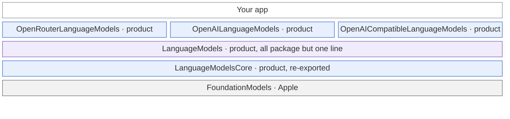
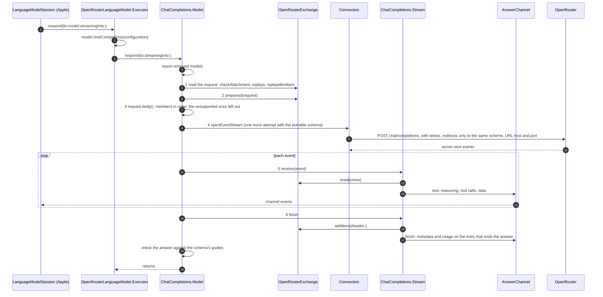
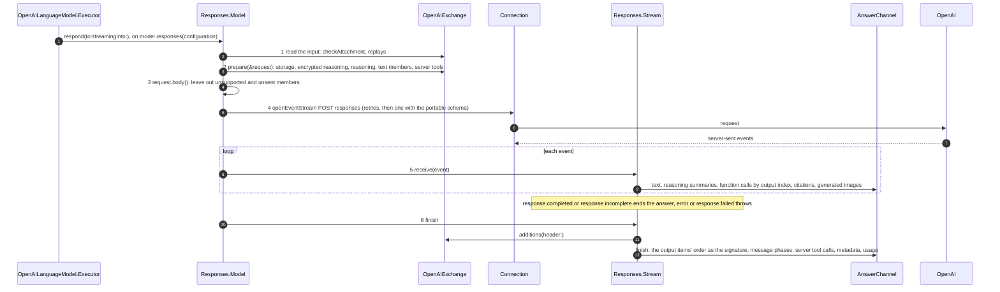
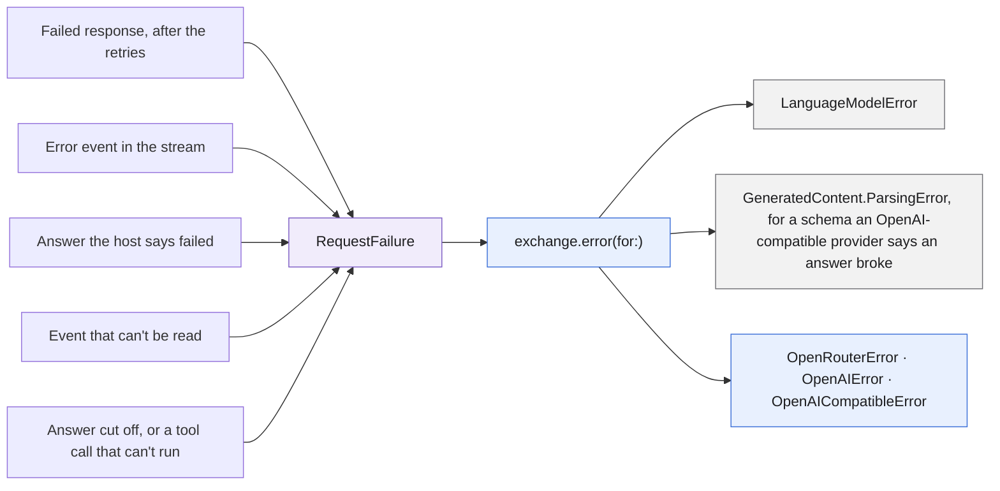
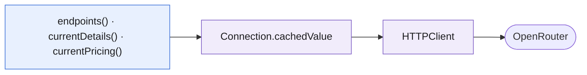
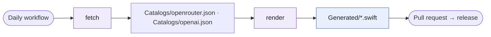

# Architecture

A map of the code for contributors: which module depends on which, how one request travels from an app to a provider
and back, and what a provider says about how it differs from a format. [CONTRIBUTING](CONTRIBUTING.md) has the rules:
where shared code goes, how a file is laid out and how it's tested.

Each word below means one thing, here, in code comments and in the docs:

| Word | Means | In code |
|---|---|---|
| **provider** | Whose API an app's requests go to. One module of this package is for one provider, apart from `OpenAICompatibleLanguageModels`, which is for any provider that speaks the formats. | `OpenRouterLanguageModels`, `OpenAICompatibleProvider`; `model.providerName`, the log's category |
| **host** | The company whose servers ran the model for one answer. With OpenAI that's OpenAI. With OpenRouter it's whoever OpenRouter routed to. A URL's host is always written "URL host". | `AnswerAdditions.host`; the log's `host …` |
| **format** | A wire format more than one provider accepts: Chat Completions, Responses. | the namespaces `ChatCompletions`, `Responses` |
| **shared model** | A `LanguageModel` that speaks one format with any provider. | `ChatCompletions.Model`, `Responses.Model` |
| **provider's model** | The public `LanguageModel` an app creates. | `OpenRouterLanguageModel`, `OpenAILanguageModel`, `OpenAICompatibleLanguageModel` |
| **model details** | A catalog entry, or a model an app describes: an id and what that model can do. | `OpenRouterModel`, `OpenAIModel`, `OpenAICompatibleModel` |
| **exchange** | One request and its answer. A provider's part in it is a value that lives as long as the exchange. | `ChatCompletions.Exchange`, `OpenRouterExchange` |
| **member** | One key and its value in a JSON body. | `ChatCompletions.Member`, `request.members` |
| **facts** | What an answer reports beyond its content: model, host, cost, usage. | `AnswerAdditions`, `providerMetadata` |

OpenRouter's public types say "provider" for the host, as OpenRouter's API does: `OpenRouterProviderName`,
`OpenRouterResponseMetadata.provider`. The stored metadata key is `provider` too, and never changes.

## Modules



Each layer builds on the ones below it. Blue: what apps can use. Purple: a product whose own declarations apps never
see. Gray: Apple.

| Target | Holds | Access |
|---|---|---|
| `LanguageModelsCore` | The public contract every provider shares: `DetailedLanguageModel`, model details, efforts, configuration values, vocabulary, attachments, typed facts, guide violations, the logging switch. And the few internals those need: ordered JSON, the package logger, removed-model reports. | `public`, plus `package` for what the other targets call. |
| `LanguageModels` | The two shared models, and what they share: sending requests, reading Foundation Models' request, writing its channel, failures before a provider maps them. One line re-exports the core. The contract's DocC catalog lives here. | `package` for what a provider writes, the rest internal. The re-export is its one `public` line, and CI checks that. |
| `OpenRouterLanguageModels`, `OpenAILanguageModels`, `OpenAICompatibleLanguageModels` | What only that provider has: its public types, its exchange, its catalog and info calls. For `OpenAICompatibleLanguageModels`, what any provider that speaks the formats needs: a provider an app describes, its public types and one exchange for both formats. | `public`, the rest internal. |

- An app imports only the provider modules it uses. Each one re-exports `LanguageModels`, so efforts,
  `DetailedLanguageModel` and logging come with it.
- A library that needs only the contract depends on `LanguageModelsCore` alone, and compiles no HTTP code.
- OpenRouter speaks OpenAI's Chat Completions format, OpenAI its Responses format, and a provider of
  `OpenAICompatibleLanguageModels` either one, as its `OpenAICompatibleProvider` says. A provider depends on
  `LanguageModels` and nothing else of this package.
- `LanguageModelsCore` never imports `LanguageModels`. Inside `LanguageModels`, files import the core with `import` or
  `package import`, and only `Exports.swift` says `public`.
- The generator and its plugin are build tools: they write each module's `Generated/` sources and never ship.

## The two models

`ChatCompletions.Model` and `Responses.Model` are `LanguageModel`s that work alone: pointed at a server that takes the
format as it is, a shared model answers with no provider code at all, through its `PlainExchange`. That's what the tests
of a format run on.

A shared model owns the whole exchange. Its `respond` reports removed models, calls its private `run`, and checks the
answer against the schema's guides. `run` is one method, in six numbered steps: read the request, let the exchange
prepare it, build the body, send it, stream the answer, end it.

A provider's model is a different type. An app creates it, and its nested `Executor` is the `LanguageModelExecutor`
Foundation Models calls. `respond` there is one line: it derives a shared model and hands the request on.

```swift
try await model.chatCompletions(configuration).respond(to: request, streamingInto: channel)
```

## One request

A Chat Completions request, from OpenRouter's model:



Where each step lives:

| Step | File |
|---|---|
| OpenRouter's entry | `Sources/OpenRouterLanguageModels/OpenRouterLanguageModel.swift`, `Executor.respond` |
| OpenRouter as a Chat Completions provider, and all it does in a request | `Sources/OpenRouterLanguageModels/Internal/OpenRouterExchange.swift` |
| The checks and the exchange | `Sources/LanguageModels/Models/ChatCompletions/ChatCompletionsModel.swift` |
| 1 and 3: the request and its body | `ChatCompletionsRequest.swift`, with the transcript in `ChatCompletionsTranscript.swift` |
| 4: sending | `Sources/LanguageModels/Shared/Connection.swift`, `HTTPClient.swift` |
| 5 and 6: the stream | `ChatCompletionsStream.swift` |
| Channel events, facts, usage | `Sources/LanguageModels/Shared/AnswerChannel.swift` |
| Failures | `RequestFailure` in `Shared/RequestFailure.swift`; the mapping in `OpenRouterError.swift` |

## A Responses request

OpenAI's model takes the same path, with the other shared model in the middle:



| Step | File |
|---|---|
| OpenAI's entry | `Sources/OpenAILanguageModels/OpenAILanguageModel.swift`, `Executor.respond` |
| OpenAI as a Responses provider | `Sources/OpenAILanguageModels/Internal/OpenAIExchange.swift` |
| The checks and the exchange | `Sources/LanguageModels/Models/Responses/ResponsesModel.swift` |
| 1 and 3: the request and its body | `ResponsesRequest.swift`, over `ResponsesInput.swift` and `ResponsesReplay.swift` |
| 5 and 6: the stream | `ResponsesStream.swift` |

## An OpenAI-compatible request

`OpenAICompatibleLanguageModel.Executor` takes either path, as its provider's format says: into
`model.chatCompletions(configuration)` or `model.responses(configuration)`, both in
`Sources/OpenAICompatibleLanguageModels/Internal/OpenAICompatibleExchange.swift`. One exchange,
`OpenAICompatibleExchange`, serves both formats, and reads what differs from the `OpenAICompatibleProvider` the model
runs on: a preset sets internal values there, such as the members its provider refuses, and a provider an app describes
keeps their defaults. The mapping of a failure is in `OpenAICompatibleError.swift`, and the reasoning that goes back on
later turns, by provider, in `Internal/OpenAICompatibleReasoning.swift`.

## What a provider states

A provider says how it differs from the plain format in three places. A provider that takes the format as it is states
none of them, apart from the required values on the model and what a failure becomes.

**On the model,** once, in `chatCompletions(_:)` or `responses(_:)`, what's true for every request:

| Value | Format | OpenRouter | OpenAI | OpenAI-compatible |
|---|---|---|---|---|
| `name`, `url`, `connection`, `providerName`, `capabilities`, `reaching:` | both, required | the variant's model id, a proxy's URL, session, auth and timeouts, `OpenRouter` | the model's id, a proxy's URL, session, auth and timeouts, `OpenAI` | the model's id, the provider's URL or a proxy's, session, auth, the provider's headers and timeouts, the provider's name |
| `memberOrder` | Chat Completions | the member order hosts cache on | | the format's, with `stream_options`, `reasoning_effort`, `thinking` and `top_k` in it |
| `unsupportedMembers` | both | the listed members the model's details don't list | the same | the members a preset's provider refuses, ignores or doesn't document |
| `media` | Chat Completions | AIFF, M4A, AAC, FLAC and OGG audio, and video | | |
| `finishReasons` | Chat Completions | | | the preset's: DeepSeek's `insufficient_system_resource` and `aborted` and vLLM's `abort` as `error`, Mistral's `model_length` and vLLM's `repetition` as `length` |
| `countsUnlistedTokensAsReasoning` | Chat Completions | | | `true` for Gemini, whose usage counts a model's reasoning only in `total_tokens` |
| `images` | both, required | the configuration's `ImageEncoding` | the same | the same |
| `reasoningOrigin` | both, required | `openrouter` | `openai-responses` | `openai-compatible/`, or `openai-compatible-responses/` on Responses, and the provider's name |
| `instructionsRole` | Responses | | `developer` for a model that reasons, `system` otherwise | |
| `phasesKey` | Responses, required | | `openAI.phases` | `openAICompatible.phases` |
| `serverToolsKey` | Responses, required | | `openAI.serverTools` | `openAICompatible.serverTools` |

**On the exchange,** the methods of `ChatCompletions.Exchange` or `Responses.Exchange`, in the order a request calls them.
The model holds one exchange value, and each request works on a copy, so what one answer reported never reaches the
next. Every method but `error(for:)` has a default that adds nothing:

| Method | Format | OpenRouter | OpenAI | OpenAI-compatible |
|---|---|---|---|---|
| `checkAttachment(_:in:)` | both | which inputs the models take | which inputs the model takes | images with vision, but not at a web address for a preset whose provider refuses one, such as Ollama, and the data kinds the details list |
| `replays(_:)` | both | only to the model that wrote it, not a fallback | only to the model that wrote it, or to the model it's a dated snapshot of | on Responses, to the model that wrote it or the model it's a dated version of; on Chat Completions as the preset says, such as any of DeepSeek's models, or only the Groq, Ollama or vLLM model that wrote it |
| `replayMembers(for:)` | Chat Completions | `reasoning` and `reasoning_details` on the message, none on its tool calls | | the preset's: the reasoning in DeepSeek's `reasoning_content`, or in the `reasoning` of Groq, Ollama and vLLM, on the message, or Gemini's thought signature on the first tool call or the message |
| `prepare(_:)` | both | the app's name, address and categories, the response cache, router metadata; fallbacks, routing, plugins, reasoning, penalties, server tools, cache marks | the effort, summary and storage, `text.verbosity`, `parallel_tool_calls` with the session's tools, the service tier, cache key and end user, server tools and the calls the answer keeps, `include`, the sampling a reasoning model doesn't take | on Chat Completions, `stream_options` unless the provider reports usage unasked, the preset's token-limit member, `reasoning_effort` with DeepSeek's `thinking`, and the requests a preset's provider refuses, refused; on Responses, the effort, the storage, which for xAI is off unless the app asks, and `include`; vLLM's and xAI's `top_k`, the cache key as `prompt_cache_key` where the provider takes it, and the app's members, on both |
| `read(_:)` | Chat Completions | images and reasoning details | | the delta's `reasoning_content`, or else its `reasoning`, and Gemini's thought signatures |
| `additions(header:)` | both | the host, cost, router report, cache status | the request's id | a remote preset's host, the request's id from the preset's headers, Gemini's thought signature |
| `error(for:)` | both, required | `LanguageModelError` or `OpenRouterError` | `LanguageModelError` or `OpenAIError` | `LanguageModelError` or `OpenAICompatibleError`, and `GeneratedContent.ParsingError` for a guided answer Groq says broke its schema |

**On the request,** in `prepare(_:)`, what depends on the one request. Chat Completions has `headers`, `members`,
`overridingMembers`, `sendsSessionTools`, `serverTools`, `tokenLimitMember`, `usesPortableSchema`, `instructionsMark`
and `movedEffort`. Responses has `members`, `overridingMembers`, `sendsSessionTools`, `serverTools`, `serverToolCalls`,
`reasoning`, `movedEffort`, `storage`, `include`, `textMembers` and `leftOutMembers`. An exchange can't change what the
messages say or the settings the app asked for. A provider's `members` never share a key with the format's; the app's,
in `overridingMembers`, replace the format's and the provider's and go out even when the model doesn't list them or,
on Responses, the provider doesn't take them with the request's other settings, all but the model, the transcript,
`stream` and `tools`, which the answer depends on: the request leaves those out and logs them. On Responses, an app's
`store` also decides which items go back by their ids.

Implement a method that has a default in the type that declares the conformance: only there does a misspelled one draw a
warning, which CI's `-warnings-as-errors` turns into an error, instead of silently keeping the default.

## Typed facts

Facts are typed in code and flat keys in storage. Foundation Models keeps an answer's facts as flat metadata, and saved
transcripts keep those keys, so their spellings never change. One file per module knows its keys, and they're private
there, apart from `phasesKey` and `serverToolsKey`, which a provider hands its shared model:

| Module | File | Reader |
|---|---|---|
| `LanguageModelsCore` | `ProviderMetadata.swift` | `providerMetadata`, on `Transcript.Response`, `Transcript.ToolCalls`, `LanguageModelSession.Usage` and `LanguageModelError` |
| `OpenRouterLanguageModels` | `OpenRouterMetadata.swift` | `openRouter`, in the same four places |
| `OpenAILanguageModels` | `OpenAIMetadata.swift` | `openAI`, in the same four places, and on `Transcript.DataEntry` |
| `OpenAICompatibleLanguageModels` | `OpenAICompatibleMetadata.swift` | `openAICompatible`, in the same four places |

A shared model writes what the format knows, such as the model and the finish reason, and an exchange's
`additions(header:)` adds the rest, as an `AnswerAdditions`. `channelMetadata` on `ProviderResponseMetadata` and
`ProviderUsageMetadata`, and `contextMetadata` on `ProviderErrorMetadata`, write a value under its keys.

## Errors



- A provider is handed one value, a `RequestFailure`, and reads its `kind`, `status`, `body`, `rawBody`, `retryAfter`,
  `message` and `imageEntries`, and any response header through `header(_:)`, whether the response was rejected or failed
  while it streamed. `status` is an `HTTPStatus`, named when a provider or the transport decides something for it, and
  each provider's table switches over it with no `default`.
- Failures Foundation Models has a case for become `LanguageModelError`: a rate limit, an oversized context, a
  guardrail, a refusal, a timeout or an image the host can't use. A guided answer that an OpenAI-compatible provider
  says broke its schema becomes `GeneratedContent.ParsingError`, as one that breaks its schema's guides does. The rest
  become the provider's own error, such as a rejected key, or credits or a quota that ran out. A `URLError` is rethrown
  as a failed connection's.
- `run` logs what it throws, through `RequestLog`, whose category is the provider's name. What the log says of an error
  is its kind, HTTP status, code and host, never its message, and a provider's error tells it through `LoggableError`.

## Info calls



`OpenRouterLanguageModel` and `OpenRouterModel` read a model's endpoints, current details and pricing through a
`Connection`, like chat requests, with an answer reused for the configuration's `infoCacheLifetime`, a minute by default.
The provider decodes the body and maps a failure, which reaches it as a `RequestFailure` of kind `.rejected`. OpenAI's
model has no info calls.

## The model catalog



`ModelCatalogGenerator fetch` downloads each source's documents and keeps a snapshot of them in `Catalogs/`, and
`render` turns the snapshots into typed models, efforts, vocabularies and removed models. OpenRouter's come from its
model list and API description. OpenAI's come from three: the models its `/v1/models` still serves, which needs an API
key, what models.dev says each model takes, and the effort words in its API description. A model past its shutdown day
is left out, and so is one that works only with an endpoint other than the Responses API. `model-catalog.yml` runs both
daily and opens a pull request whose release label `release.yml` reads.
